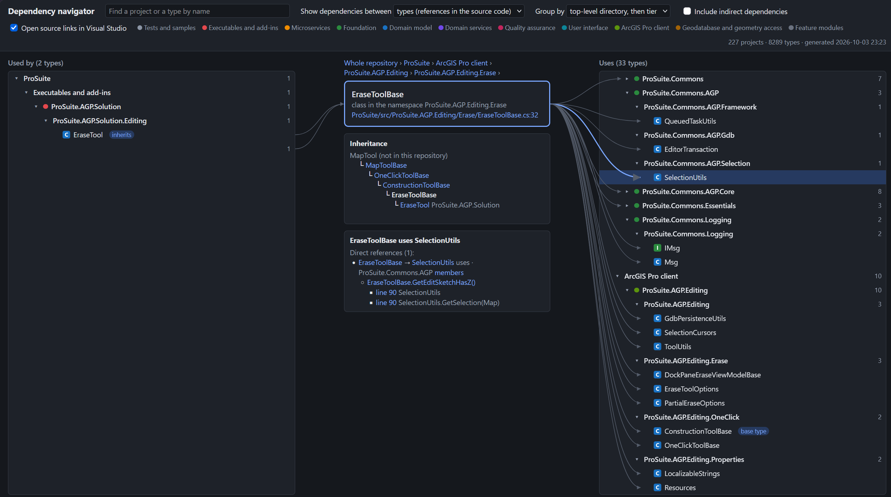

# dotnet-dependency-navigator

Browse the dependencies of a .NET code base in a hierarchical view. Select a project,
namespace or type and see what it uses and what uses it, in expandable groups. Shows
inheritance trees, lists the methods behind each reference and opens the source line in
Visual Studio. Reads C# source directly, without a build.



## What it shows

The viewer is one browser page with three columns:

| Left column | Middle column | Right column |
|---|---|---|
| What uses the focused element | The focused element | What the focused element uses |

- The focused element is a group of projects, a project, a namespace or a type.
- The side columns group their content by top-level directory and by tier, then by project,
  namespace and type. Groups are expanded only as far as the rows fit on the screen. A click
  expands a group further.
- A double click on a row makes it the new focus.
- A click on a row lists the references behind it. For a reference between two types, the
  list shows the members that cause the reference and the lines that mention the other type.
- For a focused type, the middle column shows the inheritance tree: the base classes above,
  the derived types below, and the implemented interfaces.
- A source link opens the file at the line in a running Visual Studio, or in a separate
  browser window.

Two levels of dependencies are available:

- **Projects:** the project references in the `.csproj` files.
- **Types:** the references between types in the C# source code, including inheritance and
  the implementation of interfaces.

## Requirements

- .NET 8 SDK or newer
- Windows and Visual Studio, only for opening source lines in Visual Studio

The analysed code does not have to compile, and its packages do not have to be restored.

## Getting started

Run the tool from a clone of this repository. This writes the output files for the
repository to analyse and serves the viewer at `http://localhost:5177/`:

```
dotnet run --configuration Release --project src/DependencyNavigator -- serve <repository root>
```

Or install it as a .NET tool and start it from any directory:

```
dotnet pack --configuration Release --output packages
dotnet tool install --global dotnet-dependency-navigator --add-source packages
dotnet dependency-navigator serve <repository root>
```

Without `serve`, the tool only writes the output files.

| Argument | Meaning |
|---|---|
| `serve` | Keep running and serve the viewer after writing the files. |
| `<repository root>` | The directory to analyse. Default: the git repository that contains the current directory. |
| `--output <directory>` | Where the files are written. Default: `<repository root>/dependency-navigator-output` |
| `--tiers <file>` | The tier rules file. Default: the file delivered with the tool. |
| `--port <number>` | The port of the viewer. Default: 5177 |
| `--no-browser` | Do not open the browser. |

Listing the members behind a reference and opening source files need the `serve` mode. The
tool reads the source code once at start. Restart it after the code has changed.

## Output files

| File | Content |
|---|---|
| `dependency-navigator.html` | The viewer with the data embedded. It also works when opened as a file, without the member lists and source links. |
| `architecture-overview.md` | All projects with their direct project references, and the dependencies between top-level directories and between tiers. |
| `projects/<project name>.md` | The types of one project with their file and line, what they inherit and implement, and which types of other projects they use. |
| `dependency-model.json` | The raw data. |

The text files are meant for people and for AI assistants that need an overview of a
repository without reading all of its source code.

## Tier rules

A tier rules file assigns each project to a tier by its name. The first tier with a matching
pattern wins, and `*` matches any text. The tool comes with a general file,
`src/DependencyNavigator/architecture-tiers.json`. Pass your own file with `--tiers`.

```json
{
  "tiers": [
    { "name": "Tests", "patterns": [ "*.Test", "*.Tests" ] },
    { "name": "User interface", "patterns": [ "*.UI", "*.UI.*" ] },
    { "name": "Other", "patterns": [ "*" ] }
  ]
}
```

## Limits

The tool compiles each project in memory from its source files, the projects it references
and the .NET runtime assemblies. It does not load other assemblies. Therefore:

- Types from NuGet packages and other external assemblies are unknown. A reference to a type
  of the repository is missed if it can only be resolved through such an unknown type.
- Generated code in `obj` directories is not read.
- Conditional compilation uses one fixed set of symbols.
- A nested type counts as part of the type that contains it.
- Project references that apply only under a build condition are always included.
- Only C# projects (`.csproj`) are read.

Treat the number of references as a lower bound.

## License

[MIT](LICENSE)
